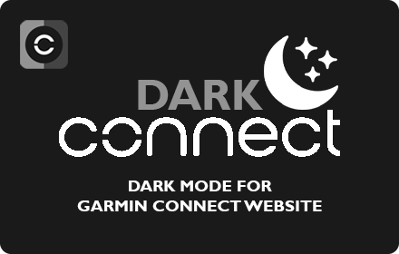
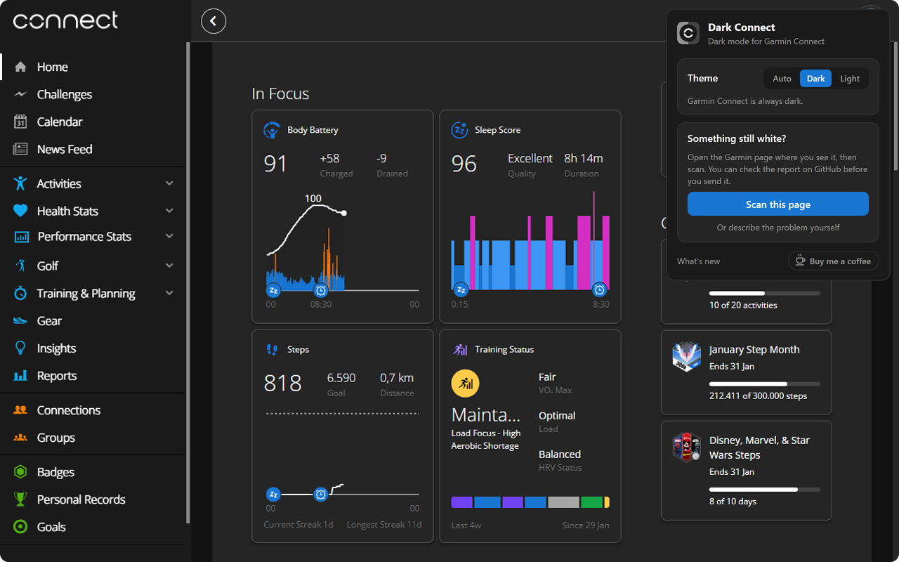
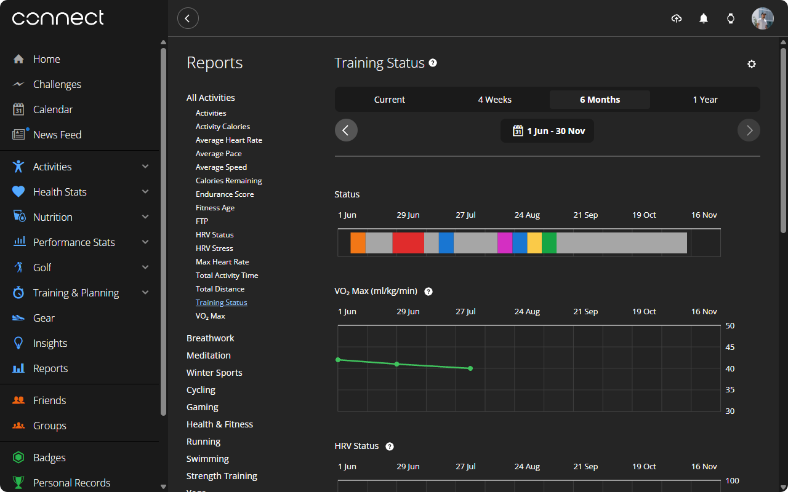
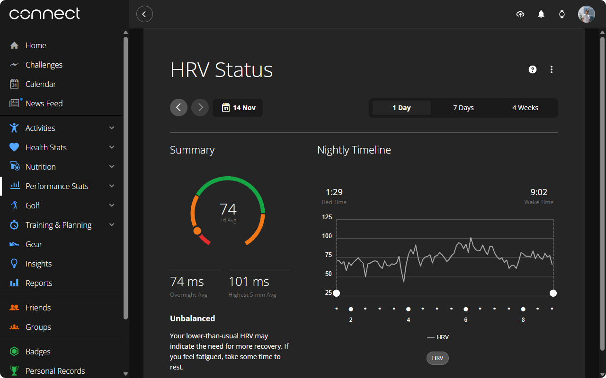
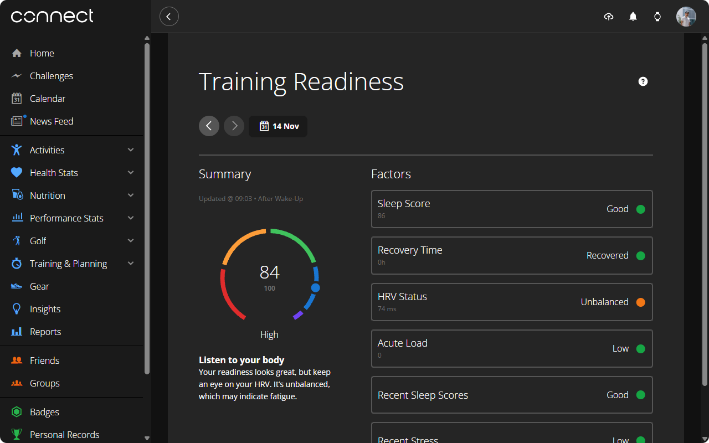

<div align="center">



<a href="https://github.com/kpulka247/dark-connect/actions" title="GitHub Actions Workflow Status"></a>
<a title="Chrome Web Store Size"></a>
<a href="https://github.com/kpulka247/dark-connect/releases" title="GitHub Release"></a>
<a href="https://github.com/kpulka247/dark-connect/blob/main/LICENSE" title="GitHub License"></a>

<a href="https://chromewebstore.google.com/detail/dark-connect/nadhhgppikppmjacnkebagbgcibnfnob" title="Chrome Web Store Users"></a>
<a href="https://chromewebstore.google.com/detail/dark-connect/nadhhgppikppmjacnkebagbgcibnfnob" title="Chrome Web Store Rating"></a>
&nbsp;&nbsp;&nbsp;&nbsp;&nbsp;&nbsp;
<a href="https://addons.mozilla.org/firefox/addon/dark-connect/" title="Mozilla Add-on Users"></a>
<a href="https://addons.mozilla.org/firefox/addon/dark-connect/" title="Mozilla Add-on Rating"></a>

</div>

## Overview

Garmin Connect has no dark mode, so Dark Connect adds one. Every page, chart and pop-up is themed by hand, because Garmin colors many features one by one and a simple "invert the colors" approach breaks its charts and brand colors. The extension only runs on Garmin's sites and leaves the rest of the web alone.

## Features

- 🌙 **Dark Garmin Connect.** Dashboards, activities, health stats, training, courses, challenges and settings, plus LiveTrack.
- 📊 **Charts that still read right.** Garmin's own chart and zone colors stay, on a dark background.
- 🌗 **Auto, Dark or Light.** Follow your device's setting, keep Garmin Connect dark, or pause the extension.
- 🔍 **Scan this page.** Something still white? One click finds it and prepares a report for us.
- 🔒 **Private.** Dark Connect collects no data and only runs on `connect.garmin.com`, `livetrack.garmin.com` and `live.garmin.com`.

## Screenshots



<details>
<summary>More screenshots</summary>







</details>

## Installation

<div align="center">

<a href="https://chromewebstore.google.com/detail/dark-connect/nadhhgppikppmjacnkebagbgcibnfnob" title="Chrome Web Store Version"></a>
<a href="https://addons.mozilla.org/firefox/addon/dark-connect/" title="Mozilla Add-on Version"></a>

</div>

Click your browser's store and add the extension. For 🦁 Brave, 🔴 Opera, or 🌀 Microsoft Edge, use the Chrome Web Store.

## Usage

Open Garmin Connect. It is dark straight away. Click the Dark Connect icon in your browser toolbar to choose **Auto**, **Dark** or **Light**.

Garmin changes its website often, and some features only appear with a Garmin Connect+ subscription or a particular watch, so a new part can show up white before it is fixed. When you see one:

1. Open the page where it is.
2. Click the Dark Connect icon and press **Scan this page**.
3. A GitHub issue opens with the details filled in. Add a screenshot if you can, and submit it.

The report contains the page address without IDs or names, the colors and the page structure, never what is written on the page. Nothing is sent until you submit the issue, and you need a free GitHub account to do it. You can also [open an issue](https://github.com/kpulka247/dark-connect/issues/new/choose) yourself.

## Development & Build

You need [Node.js](https://nodejs.org) 22 or newer, [pnpm](https://pnpm.io/) 11, and [Git](https://git-scm.com/).

```bash
pnpm install       # install dependencies
pnpm dev           # build both browsers and rebuild on every change
pnpm build         # production build with ZIPs in dist/
pnpm test          # unit tests
pnpm test:e2e      # loads the extension into Chromium on a Garmin page fixture
pnpm lint          # stylesheet checks
pnpm format        # format with Prettier
```

To try it in Chrome, open `chrome://extensions`, turn on **Developer mode**, click **Load unpacked**, and select `dist/darkconnect-chrome/`. In Firefox, open `about:debugging#/runtime/this-firefox`, click **Load Temporary Add-on**, and select `dist/darkconnect-firefox/manifest.json`. The end-to-end tests need Playwright's Chromium once: `pnpm exec playwright install chromium`.

The styles live in `src/styles/`. Shared colors are in `base/variables.css`, shared parts such as buttons and modals are in `components/`, and each Garmin area has its own file in `modules/`. [CONTRIBUTING.md](./CONTRIBUTING.md) explains how to fix a missed element, how to prove a style change keeps every color the same, and how to scan many Garmin pages at once with `pnpm sweep`.

[semantic-release](https://github.com/semantic-release/semantic-release) releases every merge to `main`. It picks the version from the commit messages, writes the changelog entry and the GitHub Release, and uploads the build to the Chrome Web Store and Firefox Add-ons.

## Contributing

> **Contributions are highly welcome!** 💖 Fixes for pages that are still light help the most, especially Garmin Connect+ and device-specific pages.

Read **[CONTRIBUTING.md](./CONTRIBUTING.md)** for the project layout, the target branch (`dev`), and the Pull Request naming rules.

If Dark Connect is useful to you, you can [buy me a coffee](https://ko-fi.com/Y8Y71ERSZF) ☕.

## License

[GPL-3.0](./LICENSE).

An unofficial project, not affiliated with Garmin. Garmin and Garmin Connect are trademarks of Garmin Ltd. or its subsidiaries.

## Changelog

Changes for each release are in [CHANGELOG.md](./CHANGELOG.md).
